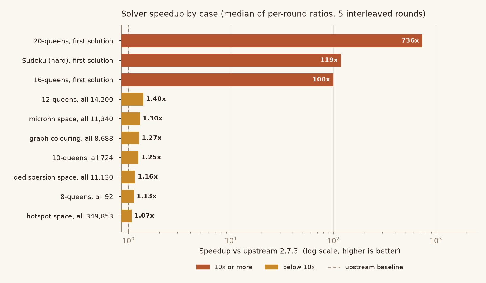
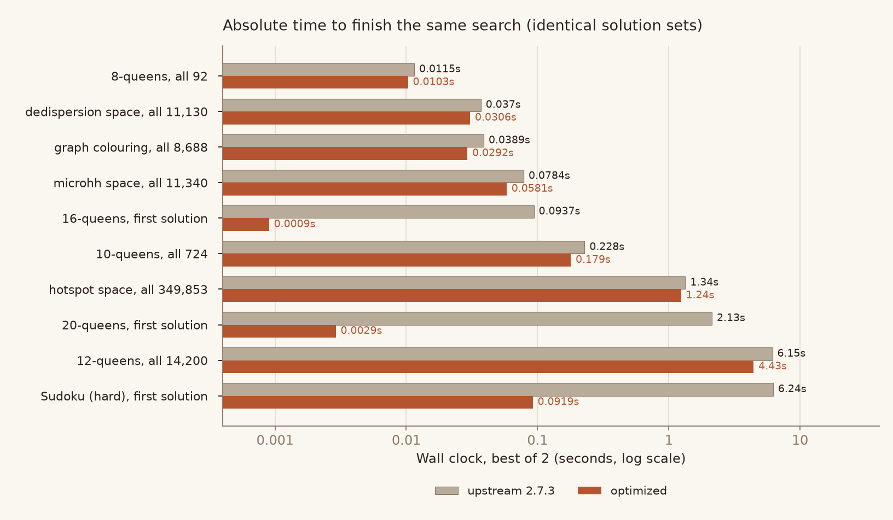
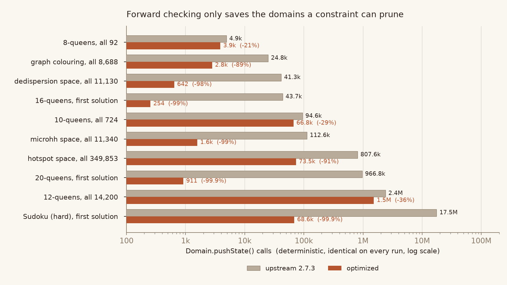

# python-constraint（求解器优化分支）

> 基于上游 [python-constraint/python-constraint](https://github.com/python-constraint/python-constraint) `main`（`v2.7.3` 之后的 `d91ba03`，BSD-2-Clause）。
> 本分支优化了**默认求解器** `OptimizedBacktrackingSolver` 的搜索循环，并修掉了一处会崩溃的空域处理缺陷。
> 其余模块、公开 API、文档、示例保持上游原样。

## 项目是什么

`python-constraint` 是一个有限域约束满足问题（CSP）求解库。声明变量、值域、约束，它返回满足全部约束的解。
常见用途：排班排课、数独、图着色、N 皇后、以及 GPU 内核参数空间枚举（仓库自带 dedispersion / microhh / hotspot 三个真实调优搜索空间）。

## 本分支改了什么

改动集中在 `constraint/solvers.py`，共三处：

1. **每个搜索节点不再重建启发式表。** 原实现每访问一个节点都要重新构造 `[(-约束数, 域大小, 变量) ...]` 列表并排序
   （`BacktrackingSolver`），或每节点扫一遍字典（`OptimizedBacktrackingSolver`）。现在 `SearchPlan` 在每次求解开始时
   构建一次：变量顺序、约束度、约束邻居表、变量到索引的映射。搜索过程中只用整数索引数组，不再触碰字典。
2. **真正的动态 MRV。** 默认求解器为了省掉每节点排序，把变量顺序固定成"搜索前算一次"，于是前向检查剪完域之后顺序就过期了。
   现在每节点用当前域大小重新选择变量（无分配、无排序的单次扫描）。
3. **前向检查只保存相关的域。** 原来每试一个值都对**所有**未赋值变量 `pushState/popState`，而约束只能剪自己声明的变量。
   现在只保存约束邻居的域。默认开启，可用 `restricted_pushdomains=False` 关闭。

另外修掉一个真实的健壮性缺陷（`constraint/constraints.py`）：
`ExactSumConstraint` / `MinSumConstraint` 的 `preProcess` 在域已被前一次求解剪空时会对空域调用 `min()`，抛 `ValueError`。
上游只给"重算"那一行加了空域保护，漏了第一次计算。

## 实测效果（相对上游 2.7.3 默认求解器）

10 个用例全部加速，且解集完全一致：



| 用例 | 加速比（逐轮比值中位数） |
| --- | --- |
| 20 皇后，求第一个解 | **736×** |
| 数独（最难档），求第一个解 | **119×** |
| 16 皇后，求第一个解 | **100×** |
| 12 皇后，枚举全部 14200 解 | 1.40× |
| microhh 参数空间，枚举 11340 解 | 1.30× |
| 图着色 16 顶点 4 色，枚举 8688 解 | 1.27× |
| 10 皇后，枚举 724 解 | 1.25× |
| dedispersion 参数空间，枚举 11130 解 | 1.16× |
| 8 皇后，枚举 92 解 | 1.13× |
| hotspot 参数空间，枚举 349853 解 | 1.08× |

绝对耗时（对数轴，同一份搜索）：



加速来自哪里，可以用确定性计数器看清楚——域状态保存次数下降 21%–99.9%：



方法、原始数据、复现命令见 [`BENCHMARKS.md`](BENCHMARKS.md)；
问题分析、复杂度与局限性见 [`IMPROVEMENT_REPORT.md`](IMPROVEMENT_REPORT.md)。
配图由 `bench/make_figures.py` 从 `bench/ab.json` 直接生成，图中没有任何手写数字。

## 安装

需要 **Python 3.11+**，无第三方运行时依赖。

```bash
cd python-constraint-opt

# 方式一：直接用源码（无需安装）
python -c "import constraint; print(constraint.__file__)"

# 方式二：安装到当前环境
pip install .
```

可选：上游支持用 Cython 编译 C 扩展（`python cythonize_build.py build_ext --inplace`，需要 Cython 与 C 编译器）。
本改动是纯 Python，编译与否都能工作。ZIP 内未附带 Cython 生成的 `.c` 文件（构建产物，约 6 MB），由构建脚本重新生成。

## 使用示例

```python
from constraint import Problem, AllDifferentConstraint

problem = Problem()                       # 默认就是优化后的 OptimizedBacktrackingSolver
problem.addVariables(["a", "b", "c"], [1, 2, 3])
problem.addConstraint(AllDifferentConstraint())

print(len(problem.getSolutions()))        # 6
print(problem.getSolution())              # 任意一个解
```

N 皇后：

```python
from constraint import Problem

n = 8
problem = Problem()
problem.addVariables(range(n), range(n))
for i in range(n):
    for j in range(i + 1, n):
        problem.addConstraint(
            lambda a, b, d=j - i: a != b and abs(a - b) != d, (i, j)
        )
print(len(problem.getSolutions()))        # 92
```

关闭优化做对照（等价于上游行为）：

```python
from constraint import Problem, OptimizedBacktrackingSolver

solver = OptimizedBacktrackingSolver(dynamic_mrv=False, restricted_pushdomains=False)
problem = Problem(solver)
```

## 运行测试

```bash
pip install pytest pytest-cov pep440
pytest tests/ -q
```

预期：**77 passed, 1 skipped, 1 failed**。唯一失败项 `tests/test_compilation.py::test_if_compiled` 要求 Cython C 扩展已编译，
纯 Python 环境下必然失败（上游同样如此，与本改动无关）。本机实测该失败在改动前后完全一致。

新增/修正的测试：
- `tests/test_solver_optimizations.py` —— 正确性、消融、边界、结构断言（共 40+ 用例）
- 其中 3 个断言原先写错了预期（详见 `IMPROVEMENT_REPORT.md` 第 7 节），已按上游真实行为修正

## 跑基准

```bash
cd bench

# 上游 vs 优化版，严格交错 5 轮（推荐）
python ab.py --rounds 5 --reps 2 --out ab.json

# 三种 MRV 策略的内部对照
python interleaved.py --rounds 5 --out policy.json

# 单包内多求解器 × 多用例
python run_bench.py --pkg ../python-constraint-opt --reps 5 --out opt.json
```

## 许可证与来源

- 上游：https://github.com/python-constraint/python-constraint ，commit `d91ba03`
- 许可证：**BSD-2-Clause**，`LICENSE` 原样保留
- 版权归上游作者（Gustavo Niemeyer、Sébastien Celles、Floris-Jan Willemsen 等）所有
- 本次改动范围与逐文件说明见 `IMPROVEMENT_REPORT.md`
- 完整 diff 见 `bench/solvers.patch` 与 `bench/constraints.patch`。两者都是标准 `a/` `b/` 补丁，
  打在上游 `d91ba03` 的对应文件上可**逐字节**还原本仓库的版本（校验脚本：`bench/make_patches.py`）：

  ```bash
  git clone https://github.com/python-constraint/python-constraint.git /tmp/pc
  cd /tmp/pc && git checkout d91ba03
  patch -p1 --binary < <此包>/bench/solvers.patch
  patch -p1 --binary < <此包>/bench/constraints.patch
  ```
